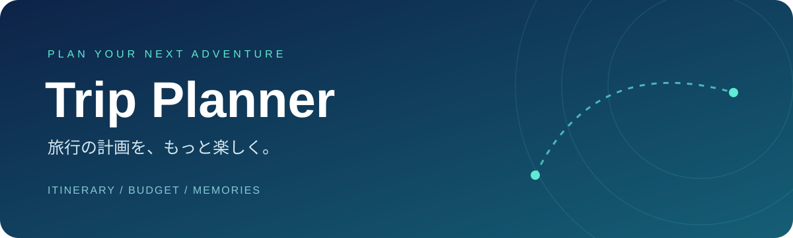

  

  <strong>旅のしおりと予算を、ひとつに。</strong> 
  行きたい場所も、使える予算も。旅行の準備をまとめて管理するWebアプリです。

  

  
  
  
  

---

## ✨ できること

| | 機能 | 内容 |
| :---: | --- | --- |
| 🧳 | 旅行プラン | 旅行名・行き先・日程・人数を登録。編集や削除にも対応 |
| 🗓️ | 旅のしおり | 日別に予定を追加し、時刻順でスケジュールを確認 |
| 💰 | 予算管理 | 1人あたりの予算 × 人数で、旅行全体の総予算を自動計算 |
| 📊 | 費用の見える化 | 交通費・食費・宿泊費などの内訳と、残り予算を表示 |
| 🧭 | ダッシュボード | 登録した旅行数・次の旅行・予定総予算をまとめて確認 |

## 🚀 使い方

1. **[アプリを開く](https://koki3190.github.io/trip-planner/)**
2. 「新しい旅行を計画する」から、日程・人数・予算を入力
3. 「旅の詳細を見る」から、各日の旅程と費用を追加
4. 「予算管理」で、内訳や残り予算を確認

> 入力データは、使用しているブラウザに保存されます。別の端末・ブラウザとの同期には対応していません。ブラウザのサイトデータを削除すると、保存した旅行も消えます。

<strong>💻 パソコンで直接起動する場合</strong>

リポジトリの **Code → Download ZIP** からダウンロードし、ZIPを展開して `index.html` をブラウザで開いてください。各CSS・JavaScriptファイルは、フォルダ構成を保ったまま配置します。

## 🛠️ 技術と工夫

- **HTML / CSS / JavaScript** で構成し、ビルドやサーバーの準備なしで起動
- **localStorage** を使い、登録した旅行・旅程をブラウザに保存
- 1人分・全員分の費用入力に対応し、グループ旅行の予算を集計
- 日付・人数・金額の入力を検証し、入力ミスを画面で案内
- スマートフォンでも使えるレスポンシブレイアウト

## 📁 ファイル構成

| ファイル | 役割 |
| --- | --- |
| `index.html` | 画面・入力フォーム |
| `style.css` | 基本のレイアウトとスタイル |
| `modern.css` | 配色・装飾・レスポンシブ調整 |
| `dashboard.css` | ダッシュボードのスタイル |
| `script.js` | 旅行・旅程の操作、予算計算、データ保存 |

## 🌱 開発について

生成AIの支援を受けて作成した、学習用の個人制作アプリです。

---

  <strong>次の旅を、ここから。</strong> 
  <a href="https://koki3190.github.io/trip-planner/">Trip Plannerを使ってみる →</a>

